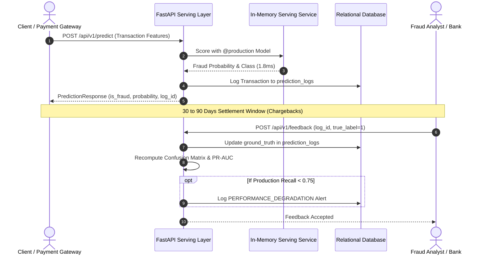
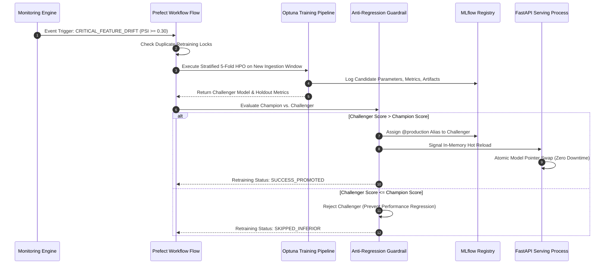
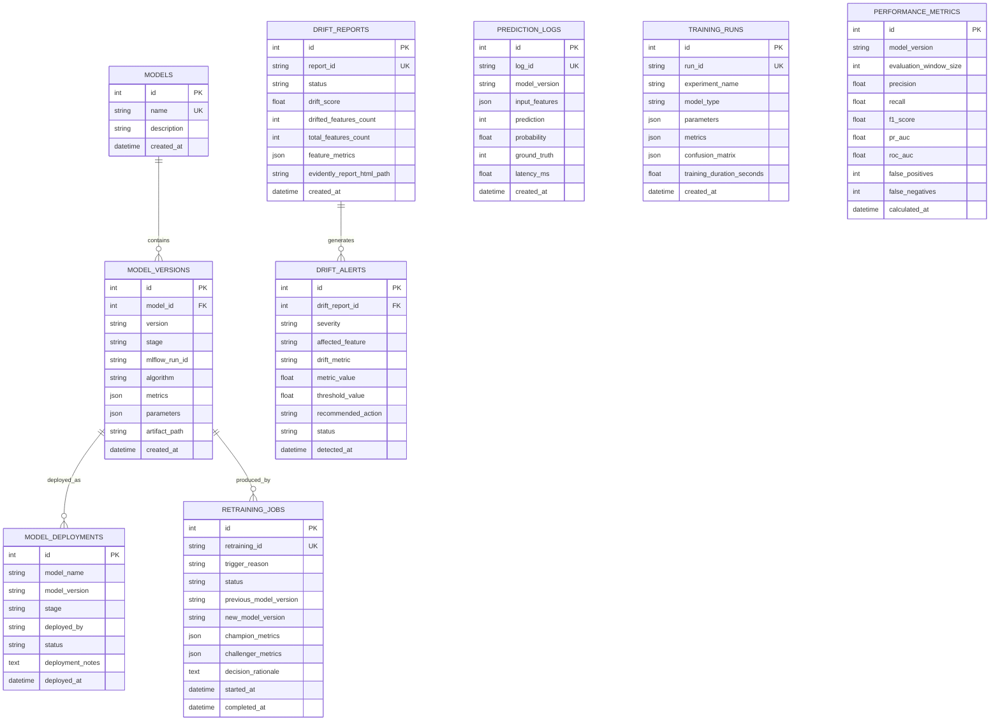

# ModelOps Hub - System Architecture & Engineering Design

---

## 1. High-Level System Architecture

```mermaid
flowchart TD
    subgraph Data_Layer ["1. Data Ingestion & Storage"]
        RawData[("Raw Transaction Data\n(creditcard.csv)")]
        ValData["Data Validator\n(Pandas & Schema Checks)"]
        SplitData["Stratified Train/Val/Test Split\n& Feature Preprocessor"]
        RefStore[("Reference Dataset Store\n(reference_data.parquet)")]
        CurrStore[("Production Inbound Stream\n(prediction_logs)")]
        RawData --> ValData --> SplitData
        SplitData --> RefStore
    end

    subgraph Training_Pipeline ["2. Automated ML Training & Optimization"]
        OptunaTune["Optuna Hyperparameter Tuning\n(Stratified 5-Fold CV)"]
        ModelTrain["Model Training\n(Logistic Regression vs XGBoost)"]
        Evaluator["Comprehensive Model Evaluator\n(PR-AUC, Recall, ROC-AUC, F1)"]
        SplitData --> OptunaTune --> ModelTrain --> Evaluator
    end

    subgraph Registry_Layer ["3. MLflow Tracking & Model Registry"]
        MLflowTrack["MLflow Experiment Tracker\n(Parameters, Metrics, Artifacts)"]
        ModelReg["MLflow Model Registry\n(Aliases: @champion, @production, @staging)"]
        Guardrail["Production Promotion Guardrail\n(PR-AUC >= 0.80, Recall >= 0.75)"]
        Evaluator --> MLflowTrack --> ModelReg
        ModelReg --> Guardrail
    end

    subgraph Database_Layer ["4. Application Database (PostgreSQL / SQLite)"]
        PostgresDB[("Metadata & State Store\n- models\n- model_versions\n- model_deployments\n- prediction_logs\n- drift_reports\n- drift_alerts\n- retraining_jobs\n- training_runs")]
    end

    subgraph Serving_Layer ["5. FastAPI Model Serving Layer"]
        FastAPIApp["FastAPI REST Server (/api/v1)"]
        ModelLoader["Dynamic Production Model Loader\n(In-Memory Hot Reloading)"]
        InferenceEngine["Preprocessed Inference Engine"]
        Logger["Prediction Audit Logger\n(Sub-5ms Latency Tracking)"]

        Guardrail --> ModelLoader --> InferenceEngine
        FastAPIApp --> InferenceEngine --> Logger
        Logger --> CurrStore
        Logger --> PostgresDB
    end

    subgraph Monitoring_Layer ["6. Statistical & Concept Drift Monitoring"]
        EvidentlyEngine["Evidently AI 0.7 Snapshot Engine\n(Interactive Plotly Dashboards)"]
        StatEngine["Statistical Drift Detector\n(Decile PSI & Two-Sample KS Tests)"]
        PerfEngine["Concept Drift / Performance Degradation\n(Delayed Ground Truth vs Predictions)"]
        AlertEngine["Drift Alert Manager\n(Severity: WARNING / CRITICAL)"]

        RefStore --> EvidentlyEngine
        CurrStore --> EvidentlyEngine
        RefStore --> StatEngine
        CurrStore --> StatEngine
        CurrStore --> PerfEngine
        EvidentlyEngine --> AlertEngine
        StatEngine --> AlertEngine
        PerfEngine --> AlertEngine
        AlertEngine --> PostgresDB
    end

    subgraph Automation_Layer ["7. Prefect Orchestrator & Retraining Loop"]
        PrefectScheduler["Prefect Workflow Orchestration"]
        RetrainTrigger{"Trigger Decision Engine\n- Critical PSI >= 0.30\n- Recall < 0.75\n- Scheduled / Manual"}
        RetrainExec["Retraining Pipeline Execution"]
        SafetyCheck{"Anti-Regression Guardrail\nComposite: 0.6*PR-AUC + 0.4*Rec\nCandidate > Production?"}

        AlertEngine --> RetrainTrigger
        PrefectScheduler --> RetrainTrigger
        RetrainTrigger -->|Trigger Fire| RetrainExec
        RetrainExec --> SafetyCheck
        SafetyCheck -->|Passed| ModelReg
        SafetyCheck -->|Rejected (Inferior)| PostgresDB
    end

    subgraph Presentation_Layer ["8. ModelOps Console (React 18 + Vite + Tailwind)"]
        OverviewDash["Overview Dashboard"]
        RegistryUI["Model Registry & Stage Governance"]
        DriftUI["Data Drift & PSI Inspector"]
        ConceptUI["Concept Drift & Delayed Feedback"]
        AlertUI["Active Alerts Center"]
        RetrainUI["Retraining Workflow Control"]
        PlaygroundUI["Live Prediction Playground"]

        OverviewDash & RegistryUI & DriftUI & ConceptUI & AlertUI & RetrainUI & PlaygroundUI <--> FastAPIApp
    end
```

---

## 2. Sequence Diagrams

### A. Real-Time Inference & Delayed Feedback Loop



### B. Automated Retraining with Anti-Regression Guardrail



---

## 3. Database Entity-Relationship (ER) Model



---

## 4. Failure Recovery & High-Availability Modes

1. **Database Fallback**: Dual-engine SQLAlchemy driver tries PostgreSQL 15 on port 5432. If PostgreSQL is offline or unreachable, it smoothly falls back to SQLite (`modelops.db`), allowing 100% functionality without requiring external infrastructure.
2. **Offline Evidently Rendering**: If network access or fonts are unavailable, the monitoring service generates an executive HTML dashboard first, and overlays Evidently AI 0.7 snapshot data without blocking the API request thread.
3. **Hot Reload Memory Isolation**: Prediction serving loads model weights into an isolated memory slot. If model reloading fails during rollback or promotion, the previous valid model remains active without serving degradation.
