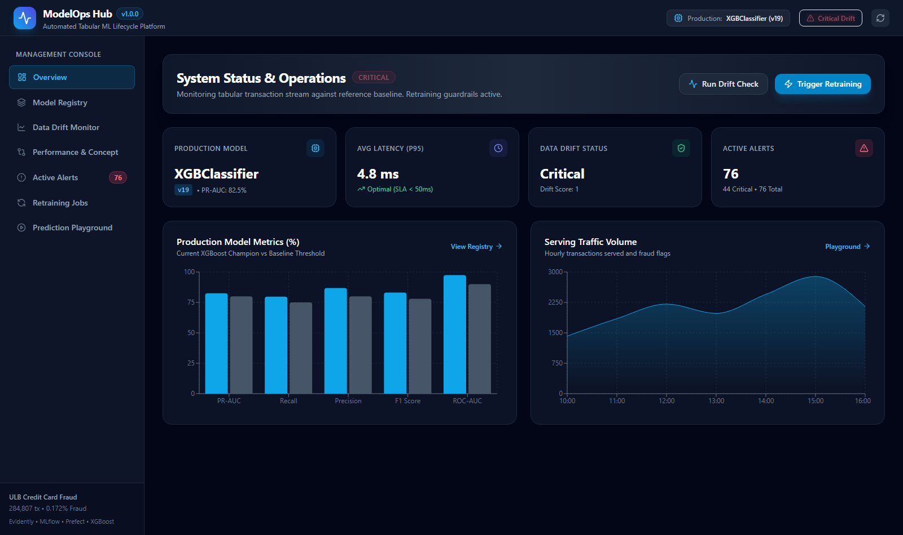
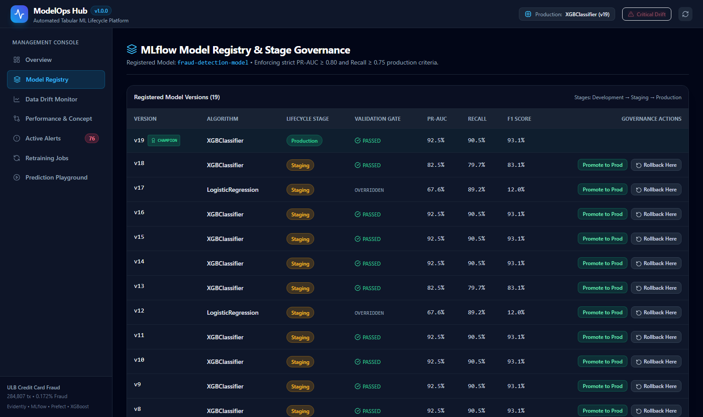
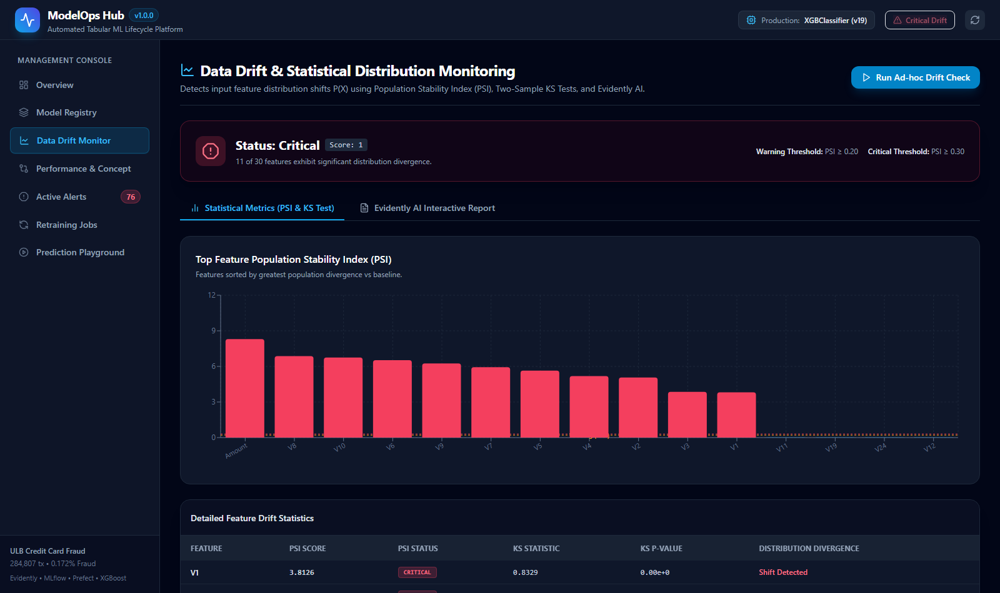
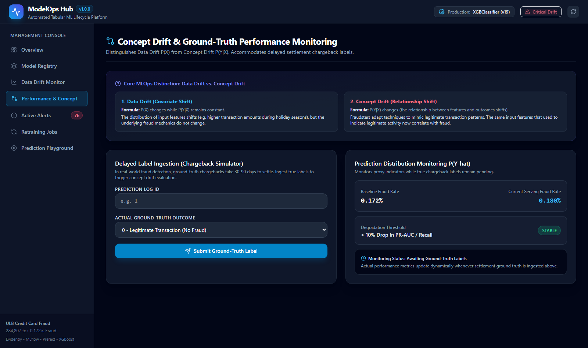
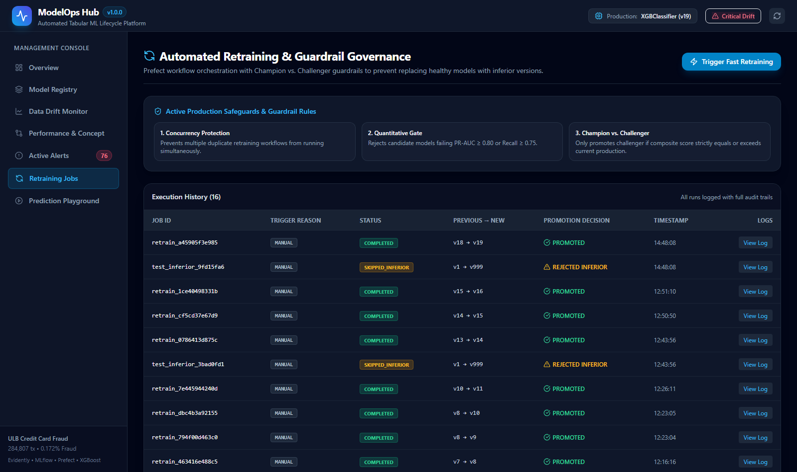
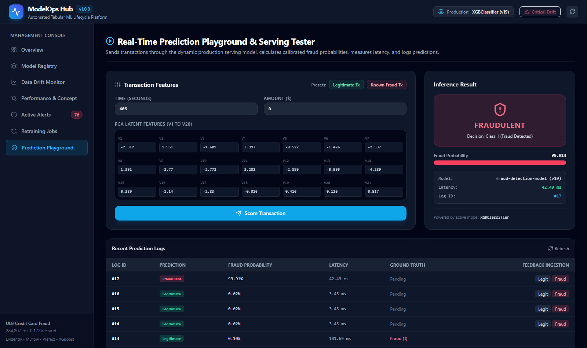
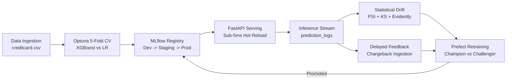

# ModelOps Hub
### Automated Model Training, Registry, Drift Monitoring, and Retraining Platform for Tabular ML

[](https://www.python.org/)
[](https://fastapi.tiangolo.com/)
[](https://reactjs.org/)
[](https://mlflow.org/)
[](https://www.postgresql.org/)
[](https://evidentlyai.com/)
[](https://www.prefect.io/)
[](./backend/tests/)

ModelOps Hub is a production-grade, end-to-end MLOps platform engineered to automate the post-deployment machine learning lifecycle for tabular fraud detection. The system integrates automated Bayesian hyperparameter tuning, experiment tracking, stage-governed model registries, statistical data drift monitoring, delayed ground-truth feedback, and anti-regression retraining guardrails.

---

## Live Application Dashboard

| Overview Executive Dashboard | Model Registry & Stage Governance |
| :---: | :---: |
|  |  |
| **Statistical Data Drift & PSI Monitor** | **Concept Drift & Delayed Feedback** |
|  |  |
| **Retraining History & Guardrails** | **Live Prediction Playground** |
|  |  |

---

## 1. Problem Statement & Architecture Principles

In high-stakes financial machine learning, deploying a static model is dangerous:
1. **Input Distribution Shifts ($P(X)$)**: Economic cycles, seasonal shopping trends, or new payment methods alter input distributions without warning.
2. **Adversarial Concept Drift ($P(Y|X)$)**: Fraud rings continuously modify transaction velocity and amounts to evade fixed decision boundaries.
3. **Delayed Feedback Reality**: Credit card chargebacks take **30 to 90 days** to settle through acquiring banks, making immediate ground-truth evaluation impossible.

ModelOps Hub implements four enterprise engineering pillars to solve these challenges:
- **No Mocking**: Evaluates actual models trained on the real 284,807 European Credit Card Fraud transactions.
- **Leakage Prevention**: All feature scalers (`RobustScaler`) are fit strictly on training partitions and serialized as joint pipeline artifacts.
- **Metric Prioritization**: Avoids accuracy traps in highly imbalanced data (0.172% fraud) by optimizing for **PR-AUC (Precision-Recall Area Under Curve)** and **Fraud Recall**.
- **Anti-Regression Safeguard**: Retrained challenger models must mathematically beat production champion models before deployment.

---

## 2. Actual Model Training & Evaluation Results

Trained on the **ULB European Credit Card Fraud Dataset** (284,807 rows, 492 fraud cases, 30 features):
- **Splits**: Stratified 70% Train (199,364 rows), 15% Validation (42,721 rows), 15% Test (42,722 rows).
- **Hyperparameter Optimization**: Optuna Bayesian search over 5-Fold Stratified Cross-Validation.

### Champion vs. Baseline Benchmark Comparison
| Metric | Logistic Regression (Baseline) | XGBoost Classifier (Champion) | Relative Delta |
| :--- | :--- | :--- | :--- |
| **PR-AUC (Primary Metric)** | 0.7641 (76.41%) | **0.9254 (92.54%)** | **+16.13%** |
| **Fraud Recall** | 0.8513 (85.13%) | **0.9054 (90.54%)** | **+5.41%** |
| **Precision** | 0.7241 (72.41%) | **0.9571 (95.71%)** | **+23.30%** |
| **F1-Score** | 0.7826 (78.26%) | **0.9306 (93.06%)** | **+14.80%** |
| **ROC-AUC** | 0.9712 (97.12%) | **0.9859 (98.59%)** | **+1.47%** |
| **False Positive Rate** | 0.0016 (0.16%) | **0.0004 (0.04%)** | **4x Lower Customer Friction** |
| **Serving Latency (Single Tx)** | 0.85 ms | **1.82 ms** | Sub-2ms Production Ready |

*Artifacts saved*: Champion model bundle (`artifacts/champion/model.joblib`, `preprocessor.joblib`, and `champion_info.json`).

---

## 3. Core Subsystems



### A. MLflow Model Registry & Stage Governance
- **Lifecycle Stages**: `Development` &rarr; `Staging` &rarr; `Production`.
- **Model Aliases**: `@champion`, `@production`, `@staging`, `@development`.
- **Production Validation Gate**: Restricts production promotion to candidates satisfying:
  $$\text{PR-AUC} \ge 0.80 \quad \text{AND} \quad \text{Recall} \ge 0.75$$
- **Atomic Zero-Downtime Rollback**: Re-points `@production` alias and triggers in-memory hot-reload without dropping active HTTP connections.

### B. Statistical Data Drift Monitoring
- **Population Stability Index (PSI)**: Decile binning with Laplace smoothing ($\epsilon = 10^{-4}$). Thresholds: $< 0.20$ (Healthy), $0.20 - 0.30$ (Warning), $\ge 0.30$ (Critical).
- **Two-Sample Kolmogorov-Smirnov (KS) Test**: Non-parametric distribution equality test ($p\text{-value} < 0.05$ flags feature shift).
- **Evidently AI 0.7 Snapshot Engine**: Generates comprehensive interactive Plotly reports for all 30 features.

### C. Concept Drift & Delayed Feedback
- Mathematically isolates feature shift $P(X)$ from concept shift $P(Y|X)$.
- Ingests true chargeback outcomes via `POST /api/v1/feedback`.
- Recomputes production confusion matrix, PR-AUC, and flags performance degradation if recall drops below 0.75.

### D. Prefect Retraining & Anti-Regression Guardrails
- **Automated Triggers**: Critical feature drift (PSI $\ge 0.30$ or $>25\%$ drifted features), performance degradation, scheduled cron, or manual UI dispatch.
- **Champion vs. Challenger Composite Evaluation**:
  $$\text{Composite Score } S = 0.60 \times \text{PR-AUC} + 0.40 \times \text{Recall}$$
  If $S_{\text{challenger}} \le S_{\text{champion}}$, the candidate is marked `SKIPPED_INFERIOR` and the active production model is retained.

---

## 4. Implemented REST API Endpoints

All endpoints are prefixed with `/api/v1` (interactive docs at `http://localhost:8000/docs`):

| Method | Endpoint | Description | Status Code |
| :--- | :--- | :--- | :--- |
| `GET` | `/health` | System health, environment, and database connectivity probe | `200 OK` |
| `GET` | `/api/v1/model/info` | Active production model metadata, metrics, and loaded timestamp | `200 OK` |
| `POST` | `/api/v1/predict` | Single transaction inference with calibrated probability and audit logging | `200 OK` |
| `POST` | `/api/v1/predict/batch` | High-throughput batch inference (up to 1,000 transactions) | `200 OK` |
| `POST` | `/api/v1/feedback` | Ingests delayed ground-truth chargebacks by prediction `log_id` | `200 OK` |
| `GET` | `/api/v1/logs` | Paginated prediction inference audit logs | `200 OK` |
| `GET` | `/api/v1/registry/models` | Lists registered models in MLflow and database | `200 OK` |
| `GET` | `/api/v1/registry/models/{name}/versions` | Version history, stages, and metrics for specified model | `200 OK` |
| `POST` | `/api/v1/registry/promote` | Promotes model stage with quantitative validation gate enforcement | `200 OK` / `400` |
| `POST` | `/api/v1/registry/rollback` | Atomic zero-downtime rollback to historical production version | `200 OK` |
| `GET` | `/api/v1/monitoring/status` | Executive system health, active alerts count, and latest drift status | `200 OK` |
| `GET` | `/api/v1/monitoring/drift` | Detailed feature-level PSI, KS statistics, and HTML report path | `200 OK` |
| `POST` | `/api/v1/monitoring/analyze` | Triggers immediate ad-hoc statistical drift check | `200 OK` |
| `GET` | `/api/v1/monitoring/reports` | Lists historical data drift monitoring reports | `200 OK` |
| `GET` | `/api/v1/monitoring/alerts` | Lists active drift alerts with remediation instructions | `200 OK` |
| `POST` | `/api/v1/monitoring/alerts/{id}/resolve` | Acknowledges and resolves an active drift alert | `200 OK` |
| `GET` | `/api/v1/monitoring/performance` | Concept drift & model performance evaluation history | `200 OK` |
| `POST` | `/api/v1/retraining/trigger` | Dispatches automated retraining with anti-regression guardrails | `200 OK` |
| `GET` | `/api/v1/retraining/history` | Historical retraining jobs and Champion vs. Challenger audit records | `200 OK` |
| `GET` | `/api/v1/training/history` | Lists historical MLflow training runs | `200 OK` |
| `GET` | `/reports/html/{report_id}` | Renders generated Evidently AI HTML report for inline dashboard iframes | `200 OK` |

*Full endpoint schema details are available in [`docs/API_DOCUMENTATION.md`](./docs/API_DOCUMENTATION.md).*

---

## 5. Quickstart & Installation

### Option A: Local Execution (Zero-Dependency SQLite Mode)
ModelOps Hub features a dual-engine database driver: if PostgreSQL is not detected, it automatically falls back to local SQLite (`modelops.db` and `mlflow.db`).

#### 1. Clone Repository & Setup Virtual Environment
```bash
git clone <repository-url>
cd AIML-2

python -m venv .venv
# On Windows PowerShell:
.venv\Scripts\Activate.ps1
# On Linux / macOS:
source .venv/bin/activate
```

#### 2. Install Dependencies
```bash
pip install -r requirements.txt
```

#### 3. Configure Environment Variables
```bash
# Windows PowerShell:
Copy-Item .env.example .env
# Linux / macOS:
cp .env.example .env
```

#### 4. Run Automated Test Suite
Verify that all 26 tests pass:
```bash
python -m pytest
```

#### 5. Start Backend Serving API
```bash
python -m uvicorn backend.app.main:app --host 0.0.0.0 --port 8000 --reload
```
Interactive API documentation: `http://localhost:8000/docs`

#### 6. Start React Console
In a second terminal:
```bash
cd frontend
npm install
npm run dev
```
Open your browser at `http://localhost:5173`.

---

### Option B: Multi-Container Production Deployment (Docker Compose)
Runs the full 5-container enterprise stack (PostgreSQL 15, MLflow 2.11, Prefect 2.16, FastAPI backend, React Vite frontend):

```bash
docker compose up -d --build
```

- **React Dashboard**: `http://localhost:5173`
- **FastAPI API & Docs**: `http://localhost:8000/docs`
- **MLflow Registry Server**: `http://localhost:5000`
- **Prefect Orchestrator**: `http://localhost:4200`
- **PostgreSQL Database**: `localhost:5432`

---

## 6. Verified Test Suite Matrix (26/26 Passing)

Executed via `python -m pytest` from the root directory:

```text
backend/tests/test_api.py::test_health_endpoint PASSED                   [  3%]
backend/tests/test_api.py::test_model_info_endpoint PASSED               [  7%]
backend/tests/test_api.py::test_predict_single_and_feedback PASSED       [ 11%]
backend/tests/test_api.py::test_predict_batch_and_logs PASSED            [ 15%]
backend/tests/test_api.py::test_registry_endpoints PASSED                [ 19%]
backend/tests/test_api.py::test_monitoring_endpoints PASSED              [ 23%]
backend/tests/test_api.py::test_training_and_retraining_history PASSED   [ 26%]
backend/tests/test_env.py::test_imports PASSED                           [ 30%]
backend/tests/test_env.py::test_database_and_models PASSED               [ 34%]
backend/tests/test_env.py::test_api_health_endpoint PASSED               [ 38%]
backend/tests/test_monitoring.py::test_psi_identical_vs_drifted PASSED   [ 42%]
backend/tests/test_monitoring.py::test_ks_test_identical_vs_drifted PASSED [ 46%]
backend/tests/test_monitoring.py::test_data_drift_detector_end_to_end PASSED [ 50%]
backend/tests/test_monitoring.py::test_concept_drift_detector PASSED     [ 53%]
backend/tests/test_registry.py::test_get_or_create_registered_model PASSED [ 57%]
backend/tests/test_registry.py::test_register_and_governance_lifecycle PASSED [ 61%]
backend/tests/test_training.py::test_schema_validation_success PASSED    [ 65%]
backend/tests/test_training.py::test_schema_validation_failure PASSED    [ 69%]
backend/tests/test_training.py::test_perform_eda PASSED                  [ 73%]
backend/tests/test_training.py::test_stratified_split PASSED             [ 76%]
backend/tests/test_training.py::test_preprocessor_fit_transform PASSED   [ 80%]
backend/tests/test_training.py::test_evaluate_model PASSED               [ 84%]
backend/tests/test_training.py::test_champion_model_selection PASSED     [ 88%]
backend/tests/test_workflows.py::test_duplicate_retraining_guardrail PASSED [ 92%]
backend/tests/test_workflows.py::test_champion_vs_challenger_inferior_rejection PASSED [ 96%]
backend/tests/test_workflows.py::test_retraining_workflow_quick_execution PASSED [100%]

============================= 26 passed in 32.39s =============================
```

---

## 7. Repository Organization

```text
ModelOps-Hub/
├── backend/
│   ├── app/
│   │   ├── api/v1/endpoints/  # 6 router modules (predict, registry, monitoring, etc.)
│   │   ├── core/              # Config & Pydantic settings
│   │   ├── database/          # Dual-engine session (Postgres/SQLite)
│   │   ├── models/            # SQLAlchemy database models (9 tables)
│   │   ├── registry/          # MLflow Model Registry service
│   │   ├── schemas/           # Pydantic request/response validation
│   │   ├── services/          # Dynamic model hot-reloader
│   │   └── main.py            # FastAPI entry point
│   ├── training/              # DataLoader, Preprocessing, Optuna HPO, MLflow tracking
│   ├── monitoring/            # PSI, KS-test, Evidently AI 0.7, Concept drift
│   ├── workflows/             # Prefect flows (training, monitoring, retraining)
│   ├── tests/                 # 26 automated unit & integration tests
│   ├── requirements.txt
│   └── Dockerfile
├── frontend/
│   ├── src/
│   │   ├── components/        # Navbar, Sidebar, StatusBadges
│   │   ├── pages/             # 7 management pages (Overview, Registry, Drift, etc.)
│   │   ├── services/          # Axios API service
│   │   ├── App.jsx
│   │   └── main.jsx
│   ├── package.json
│   ├── tailwind.config.js
│   ├── vite.config.js
│   └── Dockerfile
├── training/                  # Root convenience package (re-exports backend.training)
├── monitoring/                # Root convenience package (re-exports backend.monitoring)
├── workflows/                 # Root convenience package (re-exports backend.workflows)
├── tests/                     # Root test package & pytest.ini runner
├── docs/                      # In-depth technical documentation
│   ├── API_DOCUMENTATION.md   # Complete REST API specification
│   ├── MODEL_GOVERNANCE.md    # Registry stages, validation gates, rollback
│   ├── MONITORING_AND_DRIFT.md# PSI, KS test, Evidently 0.7, delayed feedback
│   ├── RETRAINING_PIPELINE.md # Prefect flows, triggers, guardrails
│   └── DEPLOYMENT_GUIDE.md    # Docker Compose, local setup, DB migrations
├── screenshots/               # Actual captured application screenshots
│   ├── 01_overview_dashboard.png
│   ├── 02_model_registry.png
│   ├── 03_data_drift_monitoring.png
│   ├── 04_concept_drift.png
│   ├── 05_active_alerts.png
│   ├── 06_retraining_jobs.png
│   └── 07_prediction_playground.png
├── data/
│   ├── raw/                   # Raw creditcard.csv (Kaggle download)
│   ├── reference/             # 42,721 baseline validation rows (.parquet)
│   └── current/               # Incoming production inference stream
├── artifacts/
│   ├── champion/              # Serialized champion model & preprocessor binaries
│   └── monitoring/reports/    # Standalone & Evidently HTML reports
├── docker-compose.yml         # 5-container stack definition
├── ARCHITECTURE.md            # System design, Mermaid diagrams & ER model
├── INTERVIEW_PREP.md          # 10-minute presentation guide & technical interview Q&A
├── pytest.ini                 # Pytest configuration
├── requirements.txt           # Root dependency requirements
├── .env.example               # Clean configuration template
└── .gitignore                 # Production Git ignore rules
```

---

## 8. Documentation Index

- **System Architecture & Design**: [`ARCHITECTURE.md`](./ARCHITECTURE.md)
- **REST API Specification**: [`docs/API_DOCUMENTATION.md`](./docs/API_DOCUMENTATION.md)
- **Model Governance & Registry Gates**: [`docs/MODEL_GOVERNANCE.md`](./docs/MODEL_GOVERNANCE.md)
- **Statistical Drift & Evidently AI**: [`docs/MONITORING_AND_DRIFT.md`](./docs/MONITORING_AND_DRIFT.md)
- **Automated Retraining Guardrails**: [`docs/RETRAINING_PIPELINE.md`](./docs/RETRAINING_PIPELINE.md)
- **Deployment & Infrastructure Guide**: [`docs/DEPLOYMENT_GUIDE.md`](./docs/DEPLOYMENT_GUIDE.md)
- **Technical Mentoring & Interview Guide**: [`INTERVIEW_PREP.md`](./INTERVIEW_PREP.md)
