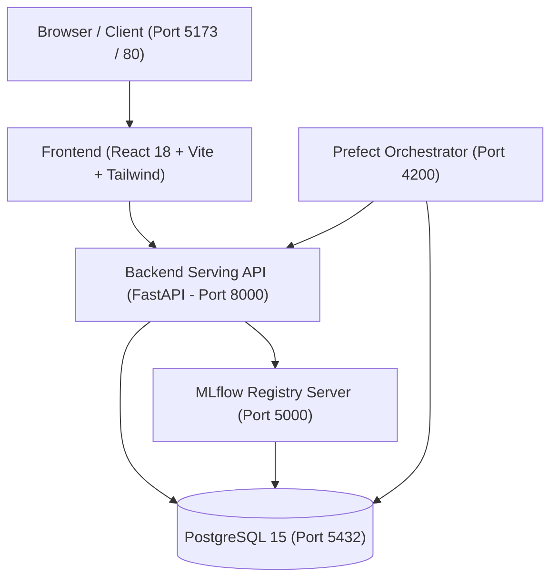

# Deployment & Infrastructure Guide

ModelOps Hub is architected for zero-friction local development as well as containerized multi-service production deployment via Docker Compose.

---

## 1. System Architecture Overview

The multi-container infrastructure comprises 5 coordinated services:



---

## 2. Option A: Local Quickstart (Zero-Dependency SQLite Mode)

ModelOps Hub includes an automated dual-engine database fallback. If PostgreSQL is not running locally, the system automatically uses SQLite (`modelops.db` and `mlflow.db`) with zero configuration required.

### Prerequisites
- Python 3.11, 3.12, or 3.13
- Node.js 18+ and npm

### Step 1: Clone & Create Virtual Environment
```bash
git clone <repository-url>
cd AIML-2

python -m venv .venv
# Windows PowerShell:
.venv\Scripts\Activate.ps1
# Linux / macOS:
source .venv/bin/activate
```

### Step 2: Install Dependencies
```bash
pip install -r requirements.txt
```

### Step 3: Configure Environment
```bash
cp .env.example .env
```

### Step 4: Run Initial Model Training (Generates Champion)
```bash
python -m backend.training.train
```

### Step 5: Start Backend API
```bash
python -m uvicorn backend.app.main:app --host 0.0.0.0 --port 8000 --reload
```

### Step 6: Start React Dashboard
In a separate terminal:
```bash
cd frontend
npm install
npm run dev
```

Open `http://localhost:5173` in your browser.

---

## 3. Option B: Production Container Deployment (Docker Compose)

### Start Full Stack
```bash
docker compose up -d --build
```

### Services & Ports
| Container | Service | URL / Port |
| :--- | :--- | :--- |
| `modelops-frontend` | React 18 Console | `http://localhost:5173` |
| `modelops-backend` | FastAPI Serving Layer | `http://localhost:8000` (`/docs`) |
| `modelops-mlflow` | MLflow Tracking & Registry | `http://localhost:5000` |
| `modelops-prefect` | Prefect Workflow UI | `http://localhost:4200` |
| `modelops-postgres` | PostgreSQL 15 Metadata DB | `localhost:5432` |

### Stop Containers & Clean Volumes
```bash
docker compose down -v
```

---

## 4. Running Automated Tests

Run the complete 26-test suite from the root directory:
```bash
python -m pytest
```
