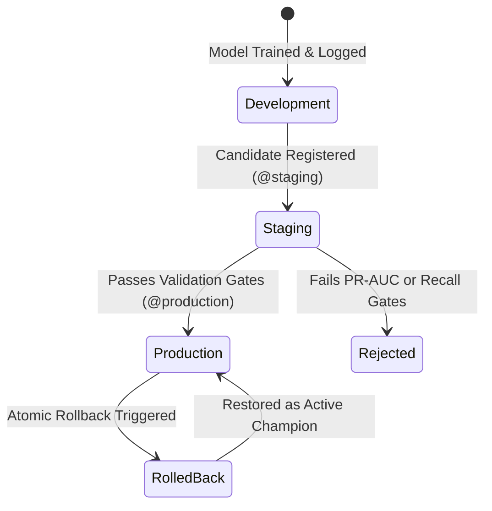

# Model Governance & Lifecycle Management

ModelOps Hub implements rigorous model governance using **MLflow Model Registry** backed by relational metadata tracking and automated validation gates.

---

## 1. Lifecycle Stages & Aliases

In modern MLOps pipelines (MLflow 2.9+ / 3.0+), stage transitions are governed via **Model Aliases** paired with relational deployment audit trails.



### Supported Aliases & Stages
| Stage / Alias | Purpose | Governance Gate |
| :--- | :--- | :--- |
| **`@development`** | Initial experiment runs logged from Optuna hyperparameter trials. | None. Unrestricted experimentation. |
| **`@staging`** | Candidate model packaged with preprocessing pipeline awaiting validation. | Cross-validation completed with full metrics logged. |
| **`@production`** | Active serving champion serving live predictions. | **Validation Gate**: $\text{PR-AUC} \ge 0.80$ AND $\text{Recall} \ge 0.75$. |
| **`@champion`** | Top-performing candidate selected by Optuna multi-metric strategy. | Highest composite score among cross-validated trials. |

---

## 2. Production Promotion Validation Gate

Direct promotion of untested or degraded models into production is strictly prevented at the API and service layer.

```python
# Validation criteria enforced in backend/app/registry/model_registry.py
if target_stage == "Production":
    pr_auc = metrics.get("pr_auc", 0.0)
    recall = metrics.get("recall", 0.0)
    
    if pr_auc < settings.RETRAINING_MIN_PR_AUC_THRESHOLD:
        raise ModelValidationError(f"PR-AUC ({pr_auc:.4f}) below threshold ({settings.RETRAINING_MIN_PR_AUC_THRESHOLD:.4f})")
    if recall < settings.RETRAINING_MIN_RECALL_THRESHOLD:
        raise ModelValidationError(f"Recall ({recall:.4f}) below threshold ({settings.RETRAINING_MIN_RECALL_THRESHOLD:.4f})")
```

Attempting to promote an inferior model raises `ModelValidationError` and emits HTTP 400 with a detailed remediation payload.

---

## 3. Atomic Zero-Downtime Rollback

If production data drift, high latency, or upstream pipeline errors occur, ModelOps Hub provides one-click atomic rollback:

1. **MLflow Alias Re-assignment**: Re-points `@production` alias to the target historical version.
2. **Audit Log Persistence**: Records `model_deployments` entry with operator, reason, and timestamp.
3. **Serving Layer Hot-Reload**: Signals `ServingService.reload_production_model()` to swap in-memory model weights without restarting FastAPI or dropping active connections.

```http
POST /api/v1/registry/rollback
Content-Type: application/json

{
  "model_name": "fraud-detection-model",
  "target_version": "1",
  "reason": "Emergency rollback: upstream feature distribution shift"
}
```

---

## 4. Metadata & Deployment Audit Schema

Every promotion and rollback is immutably recorded in the `model_deployments` relational table:

| Column | Type | Description |
| :--- | :--- | :--- |
| `id` | Integer | Primary key |
| `model_name` | String | e.g., `fraud-detection-model` |
| `model_version` | String | Deployed version string |
| `stage` | String | `Production`, `Staging`, `Archived` |
| `deployed_by` | String | System workflow or user name |
| `status` | String | `ACTIVE`, `SUPERSEDED`, `ROLLED_BACK` |
| `deployment_notes` | Text | Promotion justification or rollback trigger |
| `deployed_at` | DateTime | UTC timestamp |
